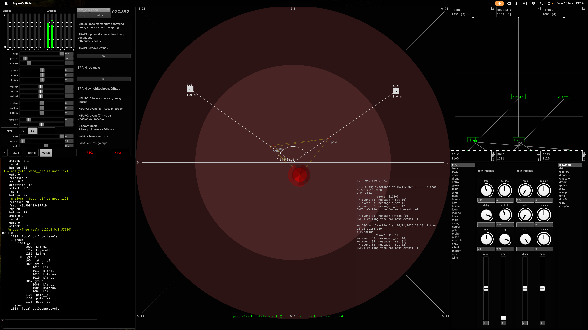

# Kinesphere

Kinesphere is a SuperCollider environment for gesture-driven, three-dimensional
sound. Tracked skeletons and sound particles inhabit a simulated world; particle
motion and world physics shape both the visualization and each sound's spatial
position.

## What it does

- Receives skeleton and joint tracking over OSC.
- Simulates particles and their interactions in a 3D world.
- Maps particle position to azimuth, distance, and elevation for surround sound.
- Provides a GUI for the world, sequence events, synthesis and physics controls,
  and speaker layout.
- Offers pitched, percussive, sample-based, and audio-through synths.
- Includes composed schedules of timed events and controllable tasks.

## Components

- `envi.scd` initializes the server, environment, synth definitions, OSC
  messaging, and world.
- `world.scd` implements the particle/skeleton world, event handling, and GUI.
- `synthdef.scd` defines sound generators, modulators, and spatialized output.
- `schedules/` contains schedules for a performance (WARNING: a "schedule" is
basically a SuperCollider script and may expect sample files or other local
resources).

## Requirements

- SuperCollider 3.10+ on MacOS or Linux
- Quarks `MathLib` and `TraerPhysics` (install them from SuperCollider's Quarks
GUI and recompile the class library).
- General `sc3-plugins` (downloadable from SuperCollider repository).
- Custom plugin `EntroServerMeter` from this repo: [sc-utils/SC3plugins/Entropia](https://github.com/deniskolokol/sc-utils/tree/main/SC3plugins)
- On Linux, a JACK-compatible setup may be needed.
- A working body tracking tool sending OSC messages to the scsynth: [BodyTrack](https://github.com/deniskolokol/bodytrack)
- A multichannel audio interface and configured server for surround playback.

Legacy version requires:

- SuperCollider 3.6+ on MacOS
- `libfreenect` for camera calibration.
- `OSCeleton` for Kinect skeleton tracking.

## Start Kinesphere

1. Install the requirements and configure your audio interface.
2. In SuperCollider, open `envi.scd` and evaluate the whole file (on macOS,
   select all and press **Cmd+Return**).
3. Wait for the server to boot and the world window to appear.



4. Start BodyTrack and point it to the scsynth's IP address and port (see
[Tracking body with a camera](https://github.com/deniskolokol/bodytrack#tracking-body-with-a-camera))
5. For legacy version start OSCeleton on Kinesphere's default port to enable tracking:

   ```sh
   /path/to/OSCeleton/osceleton -p 57120
   ```

   The environment's default OSC receiver is `127.0.0.1:57120`. Configure
   OSCeleton and the receiver consistently when they run on different machines.

## Configure the surround layout

Hold **Ctrl** and click in the world to add a speaker, then drag speakers to
match their positions around the listening area. Set **max dist** to the
farthest speaker's distance. Keep at least two speakers in the layout.

Match the layout to the interface's output routing. The default environment
uses ambisonic encoding and decodes for the configured speaker positions
automatically.

## Perform

- Load a schedule and move through its events. Events can create particles,
  change physics/audio parameters, run tasks, and issue synth commands.
- Use the buttons at the bottom of the world window to launch sounds. With
  tracking active, particles can interact with the performer's hands.
- Adjust physics, synthesis, skeleton simulation, and display controls in the
  GUI. Press **X** on the keyboard or control panel to remove particles.

  Legacy notes:
- For Kinect calibration, stand centered and facing the speakers. Adjust
  OSCeleton's depth offset if needed (for example, `-oz 0.3`); with
  `libfreenect`, `freenect-glview` can help set the camera angle.

## Sequences and recording

Sequence paths are read from `conf/sequences.conf`; the GUI can also load a
sequence file. On shutdown, the environment saves sequence paths and audio and
speaker settings. Some schedules load sample buffers, so provide any referenced
audio files before using them.

The world records multichannel AIFF files in the project's `rec/` directory.
Use the GUI recording controls; when recording the main output bus, the channel
count follows the speaker layout.

## Development notes

`TODO.md` lists possible future directions, including separating physics and
sound design and expanding visualization and control.
